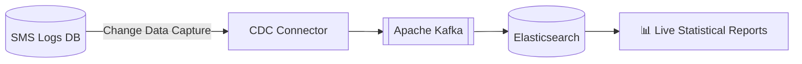

<!-- ===================== HEADER ===================== -->
<p align="center">
  
</p>

<p align="center">
  
</p>

<p align="center">
  <a href="mailto:eslamgamil6@gmail.com"></a>
  <a href="https://www.linkedin.com/in/eslam-ahmed-58b2a2247"></a>
  <a href="https://codeforces.com/profile/Eslam_Ahmed"></a>
  <a href="https://leetcode.com/u/Eslam_Ahmed/"></a>
</p>

<p align="center">
  
</p>

---

## ⚡ `whoami`

```java
package com.eslam.profile;

public class BackendEngineer {
    private final String name      = "Eslam Ahmed";
    private final String role      = "Backend Developer @ Edafa Telecom Solutions";
    private final String location  = "Cairo, Egypt 🇪🇬";
    private final String education = "Faculty of Computers & Informatics, Zagazig University";

    public String[] getCoreFocus() {
        return new String[] {
            "Legacy Modernization  -> SOAP→REST, Java 8→21, WebLogic→JBoss, EclipseLink→Hibernate",
            "Concurrency & Safety  -> Race conditions, idempotency, duplicate-free messaging",
            "Performance           -> Deep pagination fix: 800ms → 10ms, 2.5x sending speed",
            "Streaming             -> CDC → Apache Kafka → Elasticsearch for live reporting"
        };
    }

    public CompetitiveProfile getAlgorithmicStats() {
        return CompetitiveProfile.builder()
            .problemsSolved("3,500+")
            .codeforces("Expert (Max 1868)")
            .leetCode("Max 2245 (Top 0.8% Globally)")
            .achievements("ACPC 2023 Qualifier", "ECPC Problem Setter")
            .build();
    }
}
```

---

## 🔥 Production Bugs I've Killed

| 🐛 Problem | 🛠️ Fix | 📈 Result |
|:---|:---|:---|
| Campaigns slowing down over time | OFFSET pagination → cursor-based pagination + composite index | **~800ms → 10ms**, **2.5x** sending speed |
| Duplicate campaigns on server timeouts | Unique transaction-ID validation across dual backend servers | **Zero** duplicate campaigns |
| Pause/resume race condition | Bound each contact to its own list instead of shared mutable state | Correct concurrent batches |
| Re-sending after campaign resume | Persisted filtered-out contacts to compute exact restart offset | **No** repeated messages |
| Legacy SOAP clients | JSON + XML served from the same REST endpoints | **Zero** breaking changes |

<details>
<summary><b>👀 See the pagination fix</b></summary>

```diff
- SELECT * FROM contacts
-  WHERE list_id = :listId
-  ORDER BY contact_id
-  OFFSET :offset ROWS FETCH NEXT :size ROWS ONLY;   -- scans & discards every earlier row

+ SELECT * FROM contacts
+  WHERE list_id = :listId
+    AND contact_id > :lastSeenId                   -- jumps straight to the cursor
+  ORDER BY contact_id
+  FETCH NEXT :size ROWS ONLY;
+ -- backed by a composite index on (list_id, contact_id)
```

</details>

---

## 🏗️ Real-Time Analytics Pipeline (PoC)



---

## 🛠️ Tech Stack

<p align="center">
  
  <br/><br/>
  
</p>

<p align="center">
  
  
  
  
  
  
  
</p>

---

## 🏆 Competitive Programming

<table>
<tr>
<td width="50%" valign="top">

**📊 Ratings**
- 🔵 Codeforces **Expert** — Max **1868**
- 🟠 LeetCode **2245** — **Top 0.8%** globally
- 🧩 **3,500+** problems solved

</td>
<td width="50%" valign="top">

**🥇 Highlights**
- ✍️ **Problem Setter** — ECPC Qualification Round
- 🌍 **ACPC 2023** Qualifier (57th / 250+ in ECPC)
- 🥈 **2nd** — CodeChef Starters 57 (Div. 3)
- 🎯 **Round 2** — Meta Hacker Cup 2022

</td>
</tr>
</table>

> 👨‍🏫 Trained **50+** students and led **20+** sessions on advanced data structures & competitive programming.

---

<p align="center">
  <b>💬 Let's talk backend systems, concurrency, or a tough algorithm problem.</b>
</p>

<!-- ===================== FOOTER ===================== -->
<p align="center">
  
</p>
